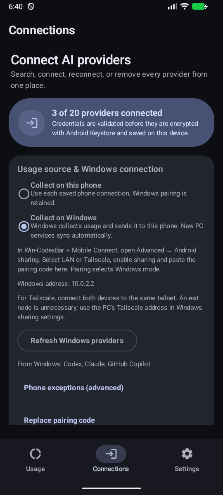
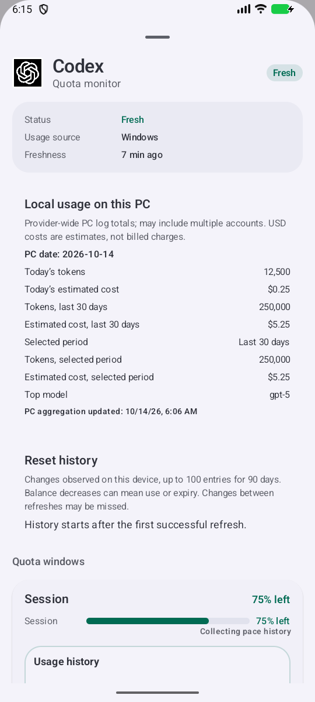

# Win-CodexBar + Mobile Connect

WindowsでAIサービスの使用量を取得し、**CodexBar for Android**へ暗号化して共有するアプリです。[nesszer/Win-CodexBar](https://github.com/nesszer/Win-CodexBar)にモバイル接続機能を加えた独立したフォークです。

## ダウンロード

**[Windows用EXEを直接ダウンロード](https://github.com/lingmulongtai/Win-CodexBar-Mobile-Connect/releases/latest/download/Win-CodexBar-Mobile-Connect.exe)** · [正式リリース・チェックサム](https://github.com/lingmulongtai/Win-CodexBar-Mobile-Connect/releases/latest) · **[署名付きAndroid APK](https://github.com/lingmulongtai/CodexBar-android/releases/latest/download/app-release.apk)**

EXEを保存して起動します。ZIP展開やNode.jsの導入は不要です。Windows 10/11 x64と[Microsoft WebView2 Runtime](https://developer.microsoft.com/microsoft-edge/webview2/)が必要です。EXEにはCランタイムとWebView2ローダーを組み込んでいます。WebView2 Runtime本体は別途必要です。

Windows版は**署名なし**です。元プロジェクトの署名証明書やインストーラーは使用しません。`SHA256SUMS`で照合できます。更新時は終了してEXEを置き換えてください。アプリ内の更新・Webサイト・問い合わせ先もこのフォークを参照します。Android APKは既存の署名を保持しており、上書きインストールで接続情報を引き継げます。

## このフォークの変更点

| 機能 | できること |
| --- | --- |
| Androidへの共有 | PCで取得済みの使用量をスマホで確認。認証情報はPCに保持。 |
| LAN・Tailscale選択 | PCのTailscaleアドレスを検出して選択。スマホのexit nodeは不要。 |
| 取得モード | スマホで取得／Windowsでまとめて取得を選択。一部サービスだけスマホにする例外も設定。 |
| PCのトークン・推定費用 | 今日・直近30日・選択期間の集計を、取得できた範囲で表示。集計日時も確認。 |
| このアプリ用の配布 | EXE直接配布、正式リリース、独立した更新先・識別子。旧Mobile Previewの設定とペアリングは保持。 |

元アプリの取得処理、トレイ、履歴、通知、テーマ、サービス設定を引き継ぎます。追加の取得プログラムを二重に動かす仕組みではありません。

## スマホとの接続

1. Windows側で使うサービスを接続・有効化します。
2. **設定 → 詳細設定 → Androidへの共有**で**Tailscale（exit node不要）**または**LAN**を選び、共有を有効にします。標準ポートはTCP **43825**です。
3. コードをAndroidの**接続 → 取得方法とWindows接続**に貼り付けて接続します。接続するとWindowsモードになります。
4. **スマホで取得**／**Windowsでまとめて取得**を選べます。認証情報、ペアリング、サービス別の例外、取得先別の履歴はモードを往復しても保持します。

外出先ではPCとスマホを同じTailscaleネットワークに接続し、共有先にPCの`100.x.x.x`アドレスを使います。スマホのexit nodeは**None／未選択**で利用でき、普段のインターネットまで自宅経由にする必要はありません。TailscaleのアクセスルールとWindows Firewallでアプリのポートへの通信が許可されている必要があります。VPNやFirewallの設定をアプリが変更することはありません。[設定ガイド](docs/android-sharing.md)

PCは起動したままにします。スマホが通常の更新タイミングでデータを取りに行くため即時プッシュではありません。PCがオフラインでもスマホの別アカウントへ自動で切り替わりません。PCで有効にした対応サービスは認証待ちのものも含めて更新時に反映します。旧版の取得先選択はスマホ例外として移行します。全取得をPCへ移すには詳細設定の**すべてWindowsから取得する**を選びます。

## 実際の画面

新しいネイティブWindowsアプリとAndroidエミュレーターで撮影しています。表示値は検証用の架空データです。画像のループバック／ホストアドレスはエミュレーター用で、実際のスマホではLANまたはTailscaleを選びます。

  
  

## データについて

使用枠、リセット時刻、取得日時、取得できた予算・残高・Codexリセットクレジットを共有します。PCログの集計はPCでの日付・集計日時を持ち、複数アカウントを含む場合があります。現在の使用枠や請求額とは別で、USD費用は推定値です。不明な値を0として表示しません。使用枠の観測が35分以上前なら古いデータ、2時間を超えれば利用不可とします。

コードはWindows DPAPI／Android Keystoreで保護し、HMAC-SHA256で要求を認証、AES-256-GCMで応答を暗号化します。メール、名前、パス、プロンプト、会話内容、サービスのトークンは送信しません。コードは私的に保管し、無効化には**ペアリングを取り消す**を使います。

**GeminiはGemini CLIの使用量です。Google Gemini Windowsアプリ／Gemini Appsの使用量は自動取得しません。** 実アカウント・実機スマホ・ランチャー・Samsung Now Barの確認は、エミュレーターの検証とは別です。[検証記録](docs/mobile-validation.md) · [v0.70.1の変更](docs/releases/v0.70.1.md)

開発方法は[English README](README.md#development)、ライセンスは[MIT](LICENSE)です。元となった[CodexBar](https://github.com/steipete/CodexBar)とWin-CodexBarの貢献者に謝意を表します。
