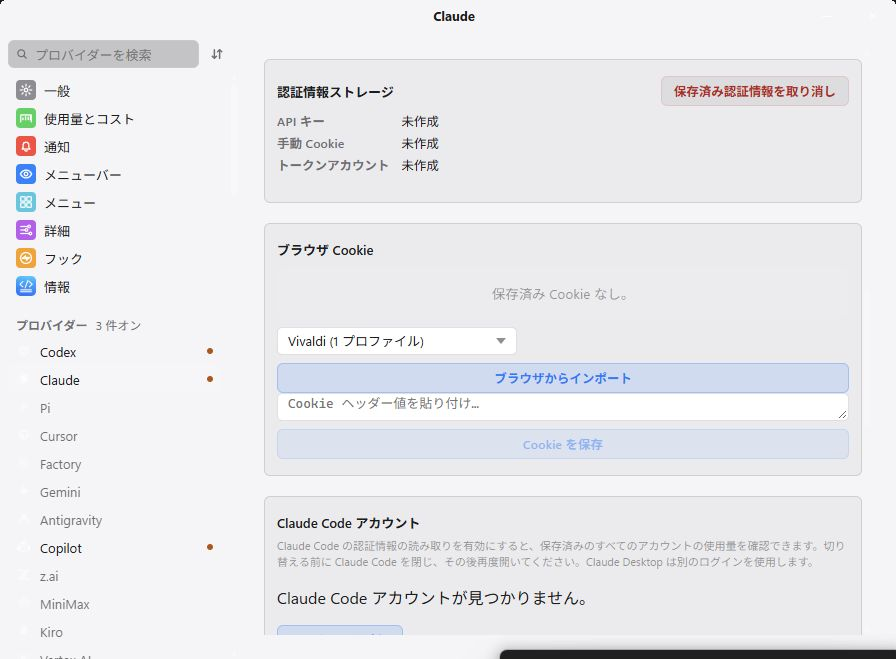
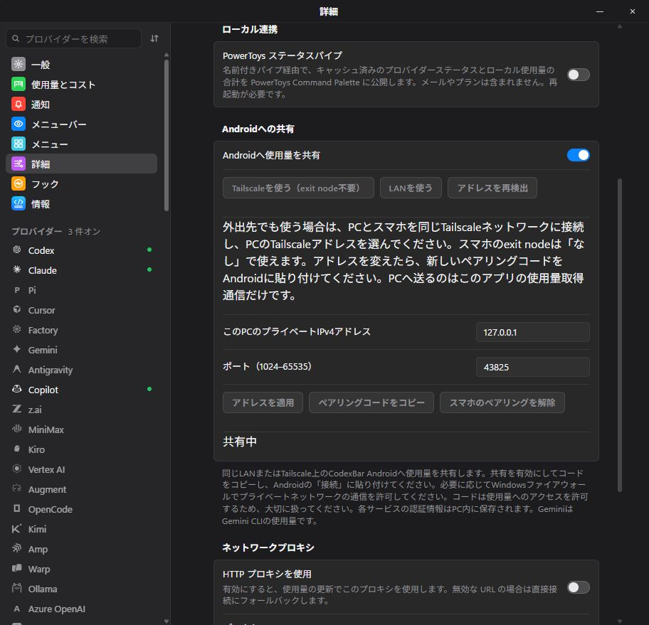
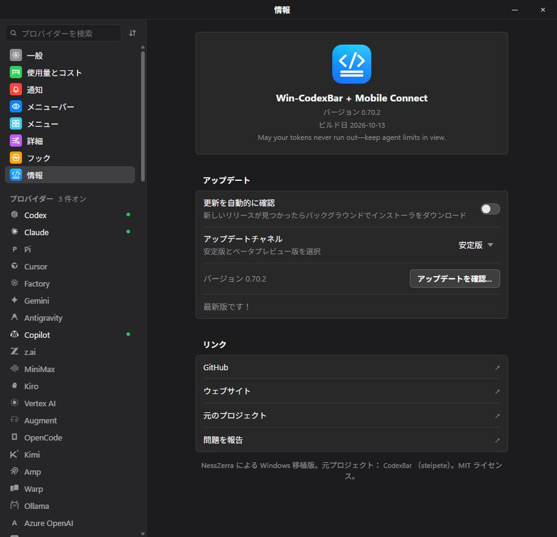
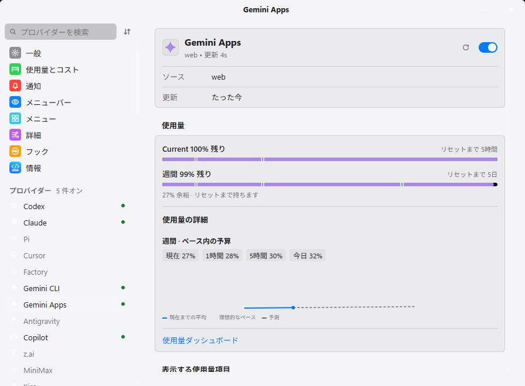
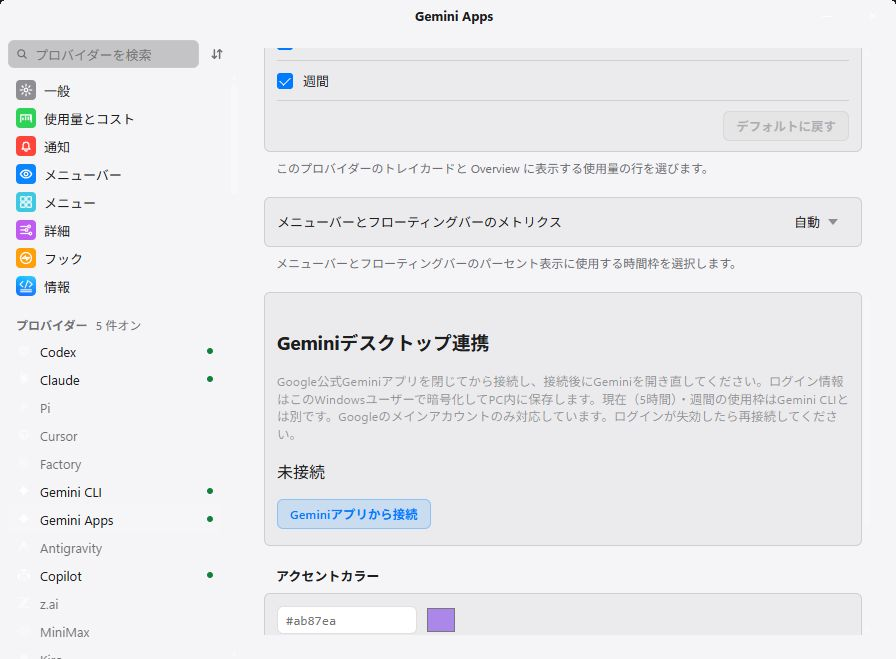

# Win-CodexBar + Mobile Connect

Android용 CodexBar에 암호화된 사용량을 공유하는 Windows 앱입니다. [Win-CodexBar](https://github.com/nesszer/Win-CodexBar)를 기반으로 독립적으로 관리하며, 원본은 [CodexBar](https://github.com/steipete/CodexBar)입니다.

**[EXE 다운로드](https://github.com/lingmulongtai/Win-CodexBar-Mobile-Connect/releases/latest/download/Win-CodexBar-Mobile-Connect.exe)** · [릴리스와 SHA256SUMS](https://github.com/lingmulongtai/Win-CodexBar-Mobile-Connect/releases/latest) · [서명된 Android APK](https://github.com/lingmulongtai/CodexBar-android/releases/latest/download/app-release.apk)

Windows 10/11 x64와 Microsoft WebView2 Runtime이 필요합니다. EXE를 저장하고 실행하면 됩니다. ZIP 압축 해제나 Node.js 설치가 필요 없습니다. 이 포크의 Windows EXE는 **서명되지 않았습니다**. 업데이트할 때 앱을 종료하고 EXE를 교체하세요.

**고급 → Android 공유**에서 LAN 또는 Tailscale을 선택하고 공유를 켠 뒤, 비공개 페어링 코드를 Android 연결 화면에 붙여 넣으세요. 두 기기는 같은 Tailscale 네트워크에 연결되어 접근이 허용되어야 합니다. 휴대전화의 exit node는 필요 없습니다. PC는 실행 중이어야 합니다. 앱은 VPN이나 방화벽을 변경하지 않습니다.

Android는 휴대전화에서 직접 수집하거나 Windows에서 수집한 데이터를 받는 모드를 제공합니다. 서비스별 휴대전화 예외도 설정할 수 있습니다. 모드 전환 시 인증 정보, 페어링 및 계정과 수집 원본별 기록을 유지합니다. PC의 알려진 서비스는 새로 고칠 때 동기화됩니다. PC가 오프라인이면 다른 휴대전화 계정으로 자동 전환하지 않습니다.

PC의 로컬 로그에서 확인되는 오늘, 최근 30일 및 선택 기간의 토큰 수와 추정 USD 비용을 상세 화면에 표시합니다. 여러 계정이 포함될 수 있으며 청구 금액과는 다릅니다. 집계 날짜와 시각을 표시합니다. **Gemini Apps는 현재·주간 사용량과 초기화 시각을 별도 연결로 가져옵니다. Gemini CLI와 구분되며 모바일 표시는 Android v0.9.8 이상이 필요합니다.** [Gemini Apps connection](docs/gemini-apps.md)

v0.70.3부터 기본 Windows 프로필의 쿠키를 가져올 때 Vivaldi를 별도로 선택할 수 있습니다. [설정 및 암호화 제한](docs/COOKIES.md).

[연결 안내](docs/android-sharing.md) · [v0.70.2 변경 사항](docs/releases/v0.70.2.md) · [검증 및 제한](docs/mobile-validation.md) · [영문 전체 README](README.md) · [이 포크에 문제 보고](https://github.com/lingmulongtai/Win-CodexBar-Mobile-Connect/issues)

네이티브 Windows와 Android 에뮬레이터에서 합성 데이터로 촬영했습니다. 실제 휴대전화와 실제 계정 검증은 아직 완료되지 않았습니다. [MIT 라이선스](LICENSE).

