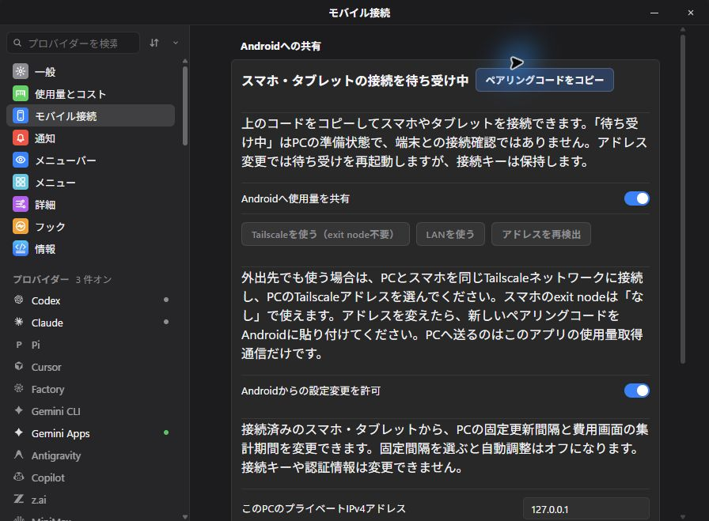

# Win-CodexBar + Mobile Connect

Windows AI usage monitoring with encrypted sharing to **CodexBar for Android**. An independently maintained fork of [nesszer/Win-CodexBar](https://github.com/nesszer/Win-CodexBar), originally based on [steipete/CodexBar](https://github.com/steipete/CodexBar).

[日本語](README.ja-JP.md) · [简体中文](README.zh-CN.md) · [繁體中文](README.zh-TW.md)

## Download

**[Download Windows EXE directly](https://github.com/lingmulongtai/Win-CodexBar-Mobile-Connect/releases/latest/download/Win-CodexBar-Mobile-Connect.exe)** · [Stable release and checksums](https://github.com/lingmulongtai/Win-CodexBar-Mobile-Connect/releases/latest) · **[Signed Android APK](https://github.com/lingmulongtai/CodexBar-android/releases/latest)**

Save the EXE in a permanent folder and run it. No ZIP extraction or Node.js installation is required. Windows 10/11 x64 and [Microsoft WebView2 Runtime](https://developer.microsoft.com/microsoft-edge/webview2/) are required. No separate VC++ Redistributable or WebView2 loader DLL is needed. The Universal CRT is included in Windows 10/11; the WebView2 Runtime itself is separate.

This fork's Windows EXE is **unsigned** and uses no upstream signing certificate or installer. Check `SHA256SUMS`. To update, quit the app and replace the EXE. The app's update screen opens this fork's releases. Android APKs retain the established production signing identity; install over the existing app to preserve connections.

## What this fork adds

The `codex/mobile-dashboard-history` development branch adds a dedicated **Mobile Connect** settings pane, encrypted shared PC quota history, Usage & Spend charts on Android/tablets and opt-in remote PC settings. **This update has not been published yet; existing stable downloads remain unchanged.** [Changes, screenshots and verification](docs/mobile-dashboard-update.md)



| Feature | Behavior |
| --- | --- |
| Android sharing | Windows collects once; the phone receives sanitized encrypted snapshots. Provider credentials stay on the PC. |
| Tailscale selection | Detect/select the PC's Tailscale IPv4 address. Same tailnet required; no exit node needed. LAN is also supported. |
| Android acquisition modes | Phone collection or Windows collection, with optional per-service phone exceptions. Pairing, choices and separate histories survive switching. |
| PC token/cost totals | Cached local-log totals for today, 30 days and the selected history period, where available, with their own aggregation timestamp. USD costs are estimates. |
| Shared history and spend | The updated PC keeps account/connection-specific history and sends the same saved series and daily reference cost/token data to paired devices. |
| Opt-in PC controls | Android can change only the PC fixed refresh interval and Usage & Spend period after local permission. Concurrent changes return a conflict. |
| Owned distribution | Direct EXE, stable releases, correct support/update links and independent app identity. Existing Mobile Preview settings/pairings are retained. |
| Vivaldi browser import | Detects standard Windows Vivaldi profiles and offers a separate choice in Browser Cookies. Existing Chromium encryption limits apply. |

The original collectors, tray, history, notifications, themes and provider settings remain the foundation. This integration does not start a second collector.

[v0.70.3 Vivaldi changes](docs/releases/v0.70.3.md) · [Browser import setup and encryption limits](docs/COOKIES.md)


## Gemini Apps

Use **v0.70.6 or later** to connect the usage limits from Google's Gemini desktop app. Current/weekly quotas and reset times are separate from Gemini CLI and Antigravity. Google session updates are retained in encrypted storage while Gemini is running; Android **v0.9.8 or later** displays the same sanitized quotas. If your older connection expired, reconnect once after updating. [Connection guide](docs/gemini-apps.md) · [v0.70.6 session renewal fix](docs/releases/v0.70.6.md)

The following native Windows captures use the downloaded, published **v0.70.6 EXE** with an isolated demo profile.


## Connect

1. Connect and enable the desired providers on Windows.
2. In the updated app, open **Settings → Mobile Connect** (published v0.70.6 and older: **Advanced → Android sharing**). Select **Tailscale (no exit node)** or **LAN**, then enable sharing. Default TCP port: **43825**.
3. Copy the private pairing code into Android **Connections → Usage source & Windows connection**, then connect. Pairing selects Windows mode.
4. Choose **Collect on this phone** or **Collect on Windows**. Advanced phone exceptions select individual services to keep on their saved phone connection.

Both devices can use the same tailnet with the phone's exit node set to **None**. Select the PC's `100.x.x.x` address; ordinary internet traffic need not pass through home. Tailscale access rules and Windows Firewall must permit the app's port. The app does not change VPN or firewall settings. [Setup and troubleshooting](docs/android-sharing.md)

Windows must remain running. Android polls during dashboard/background refreshes; delivery is not instant push. Offline Windows never silently switches to another phone account. New known Windows services are discovered at refresh, including authentication-required providers. Legacy source selections migrate to phone exceptions; **Use Windows for all services** explicitly clears them.

## Actual screens

The Windows captures are from the downloaded, published **v0.70.2 EXE**, including a completed update check. Native Windows and Android emulator captures use synthetic data. Loopback/host addresses shown here are validation endpoints; use LAN or Tailscale for a physical phone.


<p>
  
  
</p>

## Data and limits

Quota windows, reset times, observation timestamps, optional budgets/balances and known Codex reset credits are shared. Local-log totals may cover multiple accounts and are separate from the current quota account and billed charges. Unknown numbers remain unknown. Quota observations over 35 minutes old are stale; over two hours old are unavailable. Local totals have their own PC calendar date and timestamp.

Pairing uses Windows DPAPI and Android Keystore. HMAC-SHA256 requests have clock/replay checks; responses use AES-256-GCM. Provider secrets, emails, account names, local paths, prompts and transcripts are excluded. Keep pairing codes private; **Revoke paired phones** invalidates old codes.

**Gemini Apps now has its own connection for current/weekly usage and reset times. Gemini CLI remains separate. Requires Android v0.9.8 for mobile display.** [Gemini Apps connection](docs/gemini-apps.md) There is no cloud relay or phone discovery. Physical-phone, live-account, launcher and Samsung Now Bar acceptance are separate from emulator tests. [Validation evidence](docs/mobile-validation.md) · [v0.70.2 changes](docs/releases/v0.70.2.md)

## Development

```powershell
git clone https://github.com/lingmulongtai/Win-CodexBar-Mobile-Connect.git
cd Win-CodexBar-Mobile-Connect
. .\scripts\worktree-env.ps1
pnpm --dir apps/desktop-tauri install --frozen-lockfile
pnpm --dir apps/desktop-tauri run tauri:dev
```

Development requires Rust, Windows build tools and the pinned pnpm version. Run `cargo test --locked --workspace`, `cargo fmt --all -- --check`, frontend `pnpm test`, `pnpm run lint` and `pnpm run build`. Build using `pnpm run tauri:build`; raw Cargo can embed the development URL. [Repository rules](AGENTS.md)

[MIT license](LICENSE). Original collector/UI work belongs to the Win-CodexBar/CodexBar contributors. This fork has its own [issues](https://github.com/lingmulongtai/Win-CodexBar-Mobile-Connect/issues) and releases.
