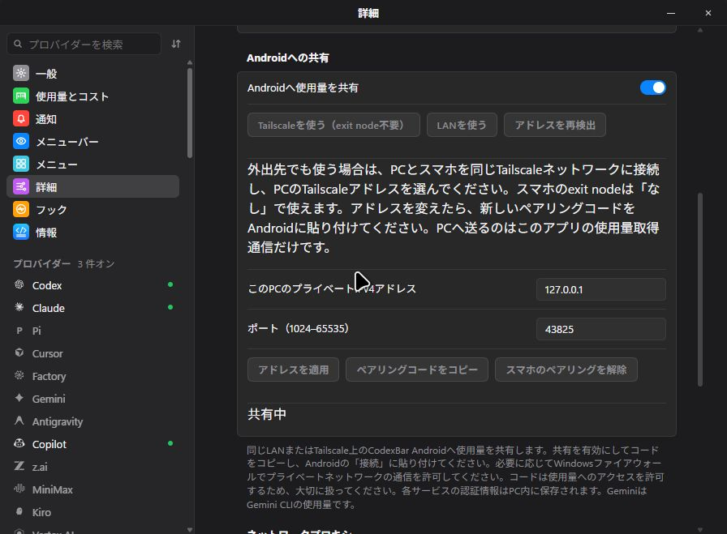

# Win-CodexBar + Mobile Connect

Android için CodexBar'a şifrelenmiş kullanım verisi paylaşan Windows uygulaması. [CodexBar](https://github.com/steipete/CodexBar) tabanlı [Win-CodexBar](https://github.com/nesszer/Win-CodexBar) projesinin bağımsız bir fork'udur.

**[EXE indir](https://github.com/lingmulongtai/Win-CodexBar-Mobile-Connect/releases/latest/download/Win-CodexBar-Mobile-Connect.exe)** · [Sürümler ve SHA256SUMS](https://github.com/lingmulongtai/Win-CodexBar-Mobile-Connect/releases/latest) · [İmzalı Android APK](https://github.com/lingmulongtai/CodexBar-android/releases/latest/download/app-release.apk)

Windows 10/11 x64 ve Microsoft WebView2 Runtime gereklidir. EXE'yi kaydedip çalıştırın; ZIP açmak veya Node.js kurmak gerekmez. Bu fork'un Windows EXE'si **imzasızdır**. Güncellemek için uygulamayı kapatın ve EXE'yi değiştirin.

**Gelişmiş → Android paylaşımı** bölümünde LAN veya Tailscale seçin, paylaşımı açın ve özel eşleştirme kodunu Android Bağlantılar ekranına yapıştırın. Cihazlar aynı Tailscale ağına bağlı olmalı ve erişime izin verilmelidir. Telefonun exit node kullanması gerekmez. PC açık kalmalıdır. Uygulama VPN veya güvenlik duvarı ayarlarını değiştirmez.

Android, telefonda veri toplama veya Windows'ta toplanan verileri alma modları sunar. Servis bazında telefon istisnaları seçilebilir. Mod değişimi kimlik bilgilerini, eşleştirmeyi ve hesap/kaynak geçmişlerini korur. Bilinen PC servisleri yenilemede eşitlenir. PC çevrimdışıysa başka bir telefon hesabına otomatik geçilmez.

Ayrıntılar, mevcutsa PC'nin yerel günlüklerinden bugün, son 30 gün ve seçilen dönem için token sayısını ve tahmini USD maliyetlerini gösterir. Birden fazla hesabı içerebilir; fatura tutarı değildir. Toplama tarihi ve saati gösterilir. **Gemini, Gemini CLI anlamına gelir; Google Gemini Apps kullanımı toplanmaz.**

[Bağlantı rehberi](docs/android-sharing.md) · [v0.70.2 değişiklikleri](docs/releases/v0.70.2.md) · [Doğrulama ve sınırlar](docs/mobile-validation.md) · [Tam İngilizce README](README.md) · [Bu fork için sorun bildir](https://github.com/lingmulongtai/Win-CodexBar-Mobile-Connect/issues)

Görüntüler yerel Windows ve Android emülatöründe sentetik verilerle alınmıştır. Fiziksel telefon ve gerçek hesap doğrulaması henüz tamamlanmamıştır. [MIT lisansı](LICENSE).
