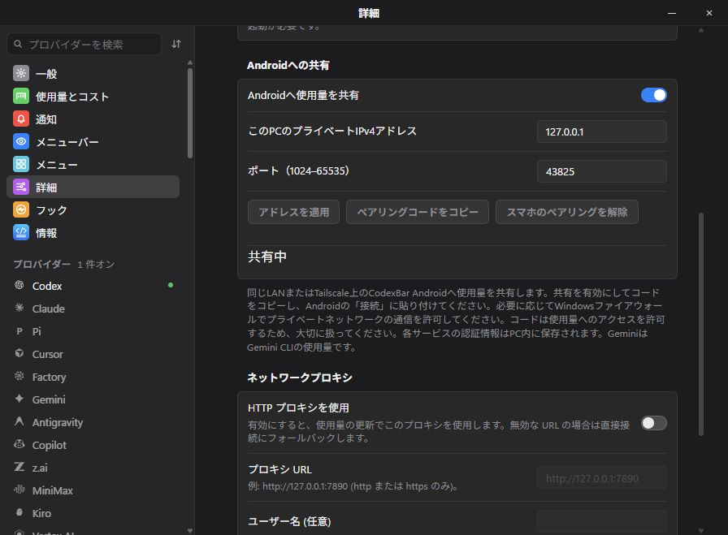

# Mobile Preview 1 validation

The preview was built from the owned `codex/android-bridge` branch on Windows using locked dependencies. The actual optimized Tauri executable was launched with a separate proof profile and a synthetic Codex observation (25% used). Existing Windows residents and real-account pairings were preserved.

## Results

- `cargo test --locked --workspace`: 4,178 core tests passed, one ignored; one CLI test and 711 Tauri tests passed.
- `cargo fmt --all -- --check` and focused core/Tauri clippy with warnings denied passed.
- All 1,108 frontend Vitest tests passed. TypeScript/Vite build, locale consistency and lint passed; lint retained seven existing warnings.
- `pnpm run tauri:build`: optimized native executable built successfully. The portable local build is unsigned; its SHA-256 is `c1334fc2143be6189ace060ca0546c8b8bfa068a629771088e2a773f4398b77d`.
- The actual Windows listener returned an authenticated encrypted snapshot to the Kotlin receiver's native interop test.
- Android API 36.1 successfully paired through the real Connections UI, stored the pairing with Android Keystore, and displayed the Windows observation as **75% left** in the normal Android dashboard. The emulator used its `10.0.2.2` host route; an incidental ADB reverse mapping was removed before dashboard verification.
- Updating the debug APK preserved the saved pairing. Restarting the optimized Windows executable preserved its DPAPI-protected pairing and enabled listener. The private pairing code was absent from the visible page.
- Revoking the pairing rejected the old key and accepted the new key. Disabling sharing from the actual UI while an invalid address draft remained closed the TCP listener and retained the last valid saved address.

CUA Driver was unavailable. The bundled Computer Use plugin captured actual Windows pixels through Windows.Graphics.Capture; CDP assertions targeted the native WebView2 application's observed debugging endpoint. The image below is from the freshly rebuilt optimized executable, not a browser recreation.

## Review and practical limits

Two independent read-only reviews found and corrected stale source publication, queued credential changes, unknown quota windows, cross-language bounds, canonical provider IDs, failure caching, reset/history scope and fork identity issues. CI's temporary path alias mismatch was fixed by giving Windows fixtures a consistent long temporary path.

Synthetic data validates the transport and UI without exposing accounts. Physical-phone pairing, real-account collection, tray menu pixels, Niagara Launcher and Samsung Now Bar remain unverified. Google Gemini Apps usage is not collected; the inherited Gemini collector is Gemini CLI. Preview updates are manual and the Windows executable is unsigned.

## Commit purposes

| Commit | Purpose |
| --- | --- |
| `10265e23` | Bind GitHub mutations to the owned fork |
| `fceffe70` | Authenticate and encrypt bounded Android snapshots |
| `11291ca7` | Separate fork configuration and updater ownership |
| `5ed26d87` | Keep current Rust compiler checks passing |
| `f0938d30` | Verify request authentication with an independent vector |
| `10ee602f` | Project only verified desktop observations |
| `bbffd04c` | Add Android sharing controls to Advanced settings |
| `7c77fda4` | Export canonical provider IDs |
| `17b3486b` | Separate notification, cache and support identities |
| `f67800e2` | Build owned previews without upstream signing |
| `0e2c72b0` | Document setup and preview limitations |
| `cb2227ef` | Normalize CI temporary paths and avoid duplicate branch runs |

The screenshot and this report are a separate evidence commit. Hosted CI and release asset verification are recorded on the PR/release, independently of these local checks.
