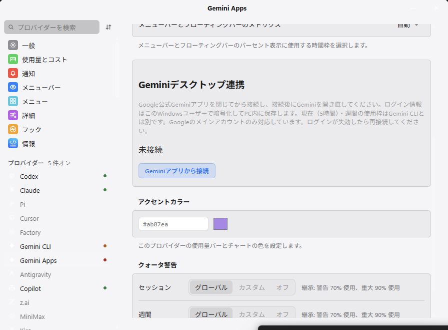

# Win-CodexBar + Mobile Connect v0.70.4

**Gemini Apps** now collects the current and weekly usage percentages and reset times shown by Google's Gemini desktop app. It is a separate provider from **Gemini CLI** and Antigravity, and shares its verified quotas with Android **v0.9.8 or later**.

1. Sign in to Google's Windows Gemini app with the primary account, then close Gemini once.
2. Enable **Settings → Providers → Gemini Apps** and click **Connect using Gemini desktop app**.
3. Reopen Gemini after connection succeeds. Later refreshes use the saved session while Gemini is open.

The connection verifies the quota API before saving the scoped session in the existing Windows-user DPAPI credential store. Provider credentials remain on Windows; Android receives only usage observations. Disconnecting removes the saved Gemini Apps session and invalidates its cached observation. Missing or malformed API data reports an error instead of inventing a zero usage value.

This screenshot was captured from the freshly built native v0.70.4 executable using an isolated synthetic profile. It shows the dedicated connection controls without account identities, cookies, chat contents or pairing secrets. Published-EXE verification is recorded separately after the stable release is downloaded.

Current and weekly quotas are compute-based percentages. This integration does not claim token totals, per-model quotas, a stable Google account identity or a verified plan-name mapping. It supports the default `/app` account route; account switching and App-Bound encrypted sessions are unsupported. The first-party API is undocumented and may change. Account-dependent mobile reset history is omitted for this provider.

Phone and tablet can pair with the same Windows code and fetch independently. Revoking that shared code disconnects every device using it. Tailscale needs no exit node when both devices can reach the selected Windows Tailscale address and TCP port 43825.

Local validation passed 4,187 core, one CLI and 716 Tauri tests with two test threads, workspace clippy, formatting, locale parity, focused UI tests and a fresh native build. One real-account cookie extraction test was deliberately excluded. The full frontend run passed 1,112/1,113 tests with a timeout in the unchanged Hooks stress test; its focused 14-test run passed. Hosted checks and release artifact validation remain separate evidence. Physical phone/tablet and off-LAN Tailscale checks are not claimed.

The direct EXE requires Windows 10/11 x64 and WebView2 Runtime. It remains unsigned. Check `SHA256SUMS` and `build-provenance.json`, exit the resident app, replace the EXE and relaunch.

[Gemini Apps setup and limitations](../gemini-apps.md) · [Android/Tailscale setup](../android-sharing.md) · [Acquisition evidence](../gemini-apps-investigation.md)

**Full changelog:** https://github.com/lingmulongtai/Win-CodexBar-Mobile-Connect/compare/v0.70.3...v0.70.4
