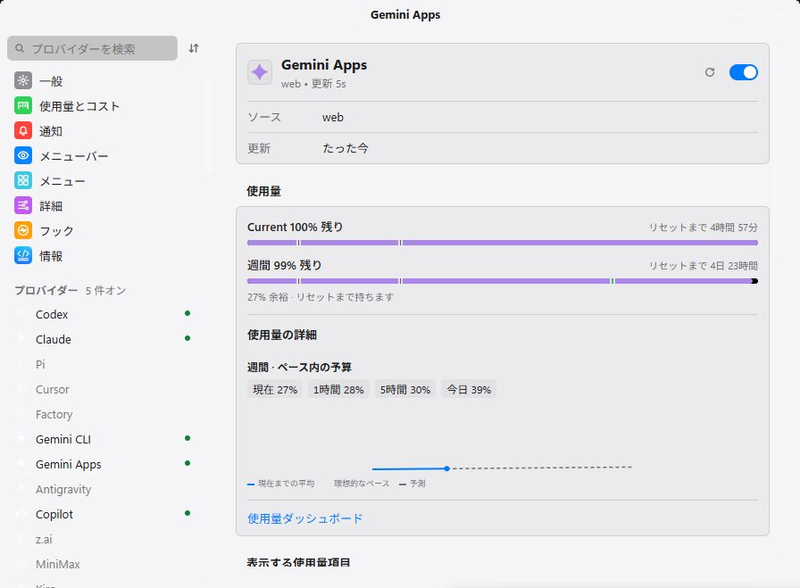
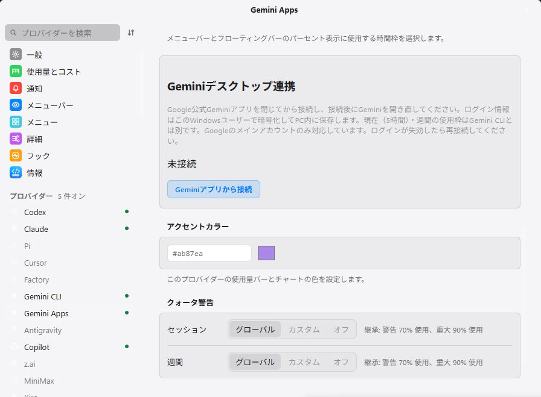

# Win-CodexBar + Mobile Connect v0.70.5

Fix Gemini Apps connections that failed with a network error in v0.70.4. The Gemini Apps collector now uses HTTP/1.1 for Google's bootstrap and quota requests because the endpoint rejected this client's HTTP/2 stream. TLS verification, redirect rejection and credential protection remain enabled.

The native Rust collector successfully fetched authenticated usage on Windows while Google's Gemini app was running, using the session saved with the user's permission in the Windows-user DPAPI store. Current/weekly usage percentages and reset times remain separate from Gemini CLI and Antigravity. Android **v0.9.8 or later** displays these sanitized observations.

[Connect Gemini Apps](../gemini-apps.md) · [Phone/tablet and Tailscale setup](../android-sharing.md)

## Downloaded EXE verification

The stable release was downloaded and verified against all three payload checksums and its build provenance. The exact x64 GUI executable is **43,973,120 bytes**, SHA-256 `393b8747f53ed83e5f6fb29105a51aa5866dff902901d1958f1399661759cdd5`, built from immutable commit `5894a8a8cffca916b7463e2ac2e637b5c558bd91` by workflow run `38625126019`. Its product/version fields and standalone runtime imports passed verification.

That published EXE was installed and launched using the ordinary Windows-user profile. It successfully refreshed both Gemini Apps usage windows and reset timestamps from the saved encrypted session while Gemini was running. Existing provider selections and pairing were retained. The installed app was then returned to normal startup without proof fixtures or remote debugging.

These two images are direct Windows.Graphics.Capture screenshots of the **downloaded, published EXE**, driven through its own WebView2. The isolated demo profile contains synthetic quotas and no Google sessions or pairing secrets. The connection screen intentionally shows the initial setup controls. No permission dialog overlays the window; the dedicated connect button is enabled and unsupported account switching is absent. Images have not been reconstructed or edited.

Hosted PR and fixed-tag checks passed: **4,190 core, one CLI and 716 Tauri tests**; one environment-dependent test remains ignored. **1,115 frontend tests** passed, together with formatting, workspace clippy, lint, TypeScript/Vite, release-pipeline checks and the optimized native build. The dedicated fresh local Tauri build and live-account fetch also passed. CUA Driver is unavailable on this host, so the bundled native Windows capture API supplied real window pixels; browser or CDP screenshots are not substituted for native captures.

The direct EXE requires Windows 10/11 x64 and WebView2 Runtime. It is unsigned. Verify `SHA256SUMS` and `build-provenance.json`, quit the resident app, replace the EXE and relaunch. Physical phone/tablet and off-LAN Tailscale acceptance remain separate from native Windows and emulator verification.

**Full changelog:** https://github.com/lingmulongtai/Win-CodexBar-Mobile-Connect/compare/v0.70.4...v0.70.5
