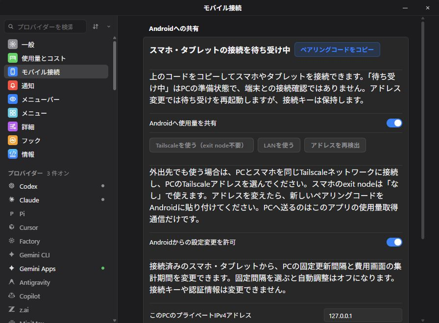
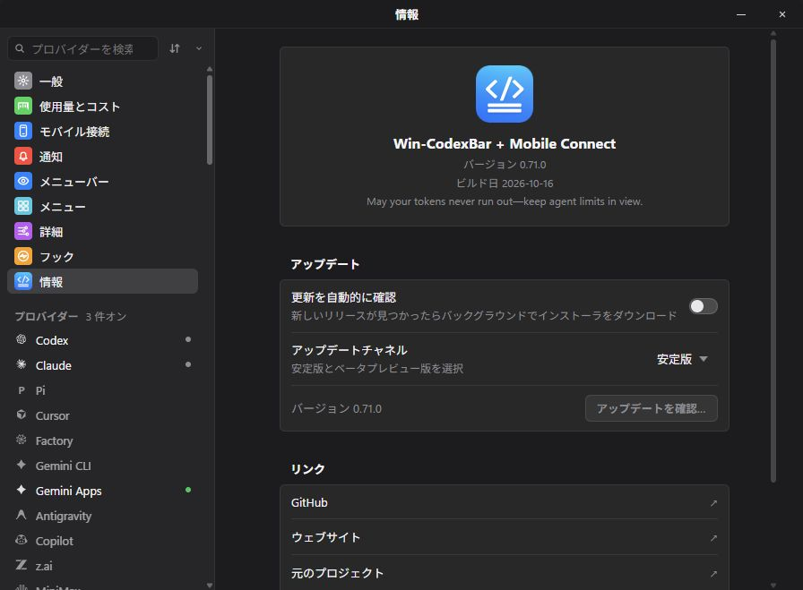

# Win-CodexBar + Mobile Connect v0.71.0

Shared PC history and daily spend now reach every paired phone and tablet through **CodexBar Android v0.10.0**. Mobile Connect has its own Settings section, with clear listener state and a pairing-code copy action that stays available while sharing runs.

- Persist quota history in encrypted account/connection archives for up to 90 days; export a bounded 30-day canonical series so devices see the same PC observations. Older phone history is not guessed into a PC account.
- Send daily reference cost and token series, 7/30-day totals and the PC dashboard's reporting period. Cost tracking must be enabled. PC background scans refresh at most once per five minutes for sharing, independently of device count. Unknown values remain unknown; valid zero remains zero.
- Optionally enable **Allow settings changes from Android** locally. Paired devices can then change only the fixed refresh interval and Usage & Spend period. Fixed intervals disable Adaptive. Revisions detect conflicting edits from multiple devices. Credentials, pairing, files and hooks stay local-only.
- Keep basic v1 quota compatibility and add authenticated v2 control resources with exact-payload HMAC and resource-bound AES-GCM responses. Revocation invalidates old control handlers before shutdown.
- Merge upstream `nesszer/Win-CodexBar` main at `079b21a354ba55ec7757353792c8921f30dfa160` (328 commits), including spend trends and provider fixes. Preserve this fork's Gemini Apps renewal, Vivaldi, owned updater/configuration and Android compatibility. Both repositories now require upstream review before every development task.

## Setup

Download **Win-CodexBar-Mobile-Connect.exe**, exit the old resident, replace the EXE and start it. Existing encrypted settings and pairing remain in place. Windows 10/11 x64 and WebView2 Runtime are required. The EXE is **unsigned**; verify SHA256SUMS and build-provenance.json. No ZIP extraction, Node.js installation or firewall/VPN changes are required by this update.

Open **Settings → Mobile Connect**, choose LAN or Tailscale, enable sharing and paste the private pairing code into Android Connections. Tailscale needs no exit node. Multiple phones/tablets can use the same code; revoking it disconnects all devices. Windows must remain running and reachable; Android polls on its normal foreground/background schedule.

## Screens and verification

The Windows images below show the downloaded, published v0.71.0 EXE on a real Windows desktop with an isolated synthetic profile. The Android image is a fresh v0.10.0 API 36.1 emulator capture with synthetic data. These do not establish live-account or physical Android device acceptance.

Local checks passed: Rust core 4,841 + CLI 1 + Tauri 773 tests (two existing ignored tests), strict workspace Clippy, 1,337 frontend tests, TypeScript/Vite, locale checks and lint (11 existing upstream lint warnings). Native Windows/Kotlin interoperability passed quota decryption and concurrent settings edits with one success/one conflict. Actual Android UI saved and restored a PC period; background WorkManager delivered four synthetic reset alerts. Physical devices, OEM battery restrictions, Samsung Now Bar and off-LAN Tailscale remain separate acceptance checks.

**Full changelog:** https://github.com/lingmulongtai/Win-CodexBar-Mobile-Connect/compare/v0.70.6...v0.71.0

## Published artifact verification

Verified on 2026-10-17 after [release run 38960419630](https://github.com/lingmulongtai/Win-CodexBar-Mobile-Connect/actions/runs/38960419630) completed successfully. The stable latest release points to merged source `651060a254891a4d6d9831f6b063ab0f09ac714a` (PR #12). Preparation commit `cd49fe559` — `chore: prepare stable Mobile Connect v0.71.0` — synchronizes product metadata and documents the release. The PR, merged-main and tag CI passed Rust/frontend checks and the portable EXE build.

- Downloaded all four release assets. All three payload hashes match `SHA256SUMS`. Build provenance matches this repository, tag, exact source commit, workflow run, version and EXE hash.
- The EXE is an x64 Windows GUI executable with product name `Win-CodexBar + Mobile Connect` and version `0.71.0`. Its import table requires no external VC++ runtime or WebView2 loader DLL. Authenticode reports `NotSigned`, matching the published provenance; WebView2 Runtime remains required.
- Replaced the installed v0.70.6 resident with these exact downloaded bytes, after backing up the old EXE and both owned configuration locations. The three saved credential/pairing files are byte-identical to their pre-update copies. The v0.71.0 resident was left running and resumed its previous sharing port.
- Captured both native screens above from the published EXE using a separate synthetic profile. The About pane shows `0.71.0`; the Mobile Connect pane displays the running listener, available copy action and separate remote-settings permission.
- Paired the actual signed, published Android v0.10.0 APK with this published EXE in the API 36.1 emulator. The Android PC settings screen saved a 7-day period, fetched it again from Windows, and successfully restored 30 days. This used the isolated synthetic profile; the installed resident's settings were not changed by this interoperability test.

EXE SHA-256: `85e3249e321088f8229d308d473fb23138e8ad0862c96d539b3c0b6478863542` (45,805,056 bytes).
