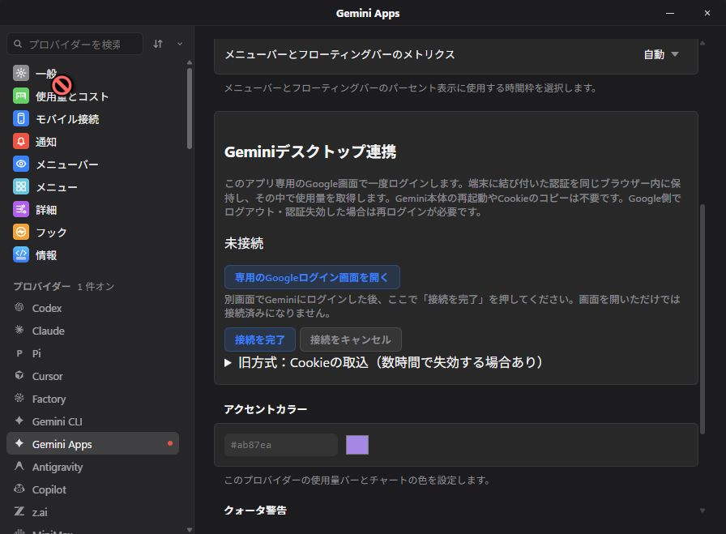

# v0.71.1 — Gemini persistent-browser validation

**Local release candidate; not published. Authenticated long-duration verification is pending.** The public stable release remains v0.71.0. No new Android APK is needed for the unchanged mobile protocol.

Google can stop accepting an exported desktop session even when `RotateCookies` returns HTTP 200. The previous 50-minute check did not catch that failure. The new connection keeps login state in a dedicated persistent WebView2 browser and reads quota inside that browser. Google sign-in is performed by the user; opening its window alone never declares success. Legacy desktop import remains available with an expiry warning.

Renewed legacy cookies are also checkpointed before subsequent quota failures, fetches are serialized, and stale writes cannot overwrite a newer selection. Browser-driven renewal retains the same mobile history connection scope. Account-indexed/ambiguous routes fail instead of substituting default-account quota. Explicit reconnect creates a new profile and preserves the previous selection until verification and saving succeed.

## Two-step verification follow-up — October 18

The user reported that Google's dedicated window hangs after two-step verification. The previous anonymous proof did not validate authenticated sign-in. The follow-up adds explicit Finish recovery in the same profile, restart-safe unfinished sign-in, bounded host-only rejection diagnostics, and an explicit browser/profile import option including Vivaldi. These are local **source-only changes**, not installed on the monitored PC.

The user subsequently connected in the original installed candidate, whose hash is recorded below. Real quota and successive collection timestamps were verified without the official Gemini app running. Its working connection is being preserved while a user-level, bounded 24-hour local monitor records fresh quota, connection/source identity, process restarts and gaps. The original loading cause remains unproven; no claim is made that the uninstalled follow-up code fixed it. Long-duration, controlled authenticated restart and sleep/resume results remain pending.

The private observation window is October 18, 06:57 through October 19, 06:57 JST. The task samples once per minute while this user session and PC are available, resumes after logon, and does not wake the PC. Sleep, offline periods and missed observations remain gaps rather than being counted as verified uptime. Task execution and isolated monitor fixtures passed; the completed 24-hour result is not yet available.

### Follow-up source validation

- Core library: 4,848 passed, two existing ignored, using the compiled test binary with four test threads. The first unrestricted parallel run timed out the existing Antigravity 500-database discovery budget; that test passed in isolation and the complete bounded-parallel rerun passed.
- Windows shell: 781 tests passed, including unfinished-profile resumption and revoked/missing-profile rejection.
- Gemini connection UI: all ten focused tests passed. TypeScript, 1,750-key locale parity, focused lint and the production frontend build passed.
- Full frontend: all 1,344 tests in 143 files passed with two workers. The first full run had one existing TrayPanel reveal-readiness timeout; all 41 tests in that file also passed on its focused rerun.
- Strict Clippy passed both Rust manifests, all targets, with warnings denied. Both formatting checks and all 29 relative documentation targets passed.
- New native recovery/import controls have not been exercised in a rebuilt EXE. The native window reader failed to respond after retry and reinitialization; it did not provide evidence of the original loading screen. The current working app is intentionally not replaced during observation. Hosted CI has not run for these local commits.

## Initial candidate validation — October 17

- Full core: 4,846 library tests and one CLI test passed; two existing ignored tests.
- Windows shell: 780 tests passed. Strict Clippy passed both manifests, all targets, with warnings denied.
- Frontend: 1,341 tests in 143 files passed; TypeScript, locale parity and the production frontend build passed. Existing unrelated lint warnings were not changed.
- Browser script: eight deterministic tests passed, including anonymous HTTP 200, account switching, oversized data and redaction.
- Native Windows: dedicated Google window opens; unauthenticated verification and repeated retry fail without saving; close hides the window while retaining the browser; cancellation deletes its actual profile and dummy cookie/local storage. Native custom-command and plugin access from Google are denied, including after JavaScript window-label spoofing. Settings, saved credentials, renewal cache and mobile pairing stayed byte-for-byte unchanged during isolated proof. [Detailed evidence](../gemini-apps-investigation.md).
- Release artifact: the static-runtime x64 GUI EXE passed PE version/import verification and the same native isolation, anonymous failure and cleanup checks. This exact EXE was installed and started on the development PC, preserving its settings and pairing; no remote debugging or synthetic usage is enabled. SHA-256: `129db3d8e527ceb7cd80ca2591639d18bf03380d7020a28e7b13e0651c247915`.
- **Not yet verified at the October 17 handoff:** authenticated quota collection, multi-hour lifetime, authenticated restart, sleep/resume, and hosted CI for this branch. Initial authenticated collection was subsequently verified on October 18 as described above. The multi-hour result remains pending; cached display and time waiting for login do not count as uptime.

The initial waiting observer was replaced after the October 18 sign-in. The current bounded monitor has started from verified quota bound to the selected browser connection, preserves its start/deadline across process restarts, and never declares stability from elapsed time alone.

## Local commits

These commits are on `codex/gemini-session-stability` and have not been pushed or tagged.

| Commit | Subject | Purpose |
| --- | --- | --- |
| `86a7d59be` | docs: merge upstream native and off-machine proof guidance | Integrate the compatible read-only upstream change at `1e0a414cc10c6429a106f4674637427333518afa`. |
| `3a25dc43a` | fix: serialize Gemini renewal and reject stale session writes | Prevent overlapping and outdated authentication writes. |
| `c837fc4ec` | fix: preserve renewed Gemini cookies across failed quota requests | Retain successful renewal when a later request fails. |
| `ce9ee144d` | feat: validate quota responses from the Gemini browser | Share bounded, strict quota parsing without exporting browser authentication. |
| `48f823418` | fix: keep committed Gemini selection after cache cleanup failures | Keep saved selection and invalidation consistent after a cleanup error. |
| `0858bb7e0` | feat: retain Gemini authentication in an isolated persistent browser | Add dedicated sign-in, verified selection, cleanup, mobile integration and remote IPC isolation. |
| `81528cf7d` | fix: allow an empty WebView2 profile override | Fix the empty-environment case found by native interaction. |
| `d538c98a0` | fix: bind Gemini quota reads to the selected default account route | Reject indexed/ambiguous account routes and changes during collection. |
| `5b8ffbcbe` | chore: prepare the v0.71.1 Gemini stability build | Keep Cargo, lockfile, Tauri and frontend versions aligned. |
| `aa1a001d3` | docs: record Gemini browser validation and pending live checks | Record the initial candidate evidence without claiming authenticated lifetime. |
| `6071b36ee` | fix: preserve inherited policy when applying Windows updates | Port upstream's compatible Windows updater policy and test-isolation fix. |
| `c3a6fd268` | fix: restore Korean quota notification text | Port six corrected upstream translations. |
| `66757eb2e` | feat: read Gemini cookies from an explicitly selected browser profile | Read only the requested Chromium profile, preserving strict cookie checks. |
| `64f1c8d0d` | fix: resume unfinished Gemini sign-in without reusing committed scopes | Recover explicit Finish and unfinished sign-in while revoking completed references. |
| `c0a0066f1` | feat: expose Gemini browser and profile connection choices | Add explicit verified browser import and retain the previous connection on failure. |

Android upstream was checked at `1811d1fe032fd4a80240fd6bc5d04cee649a0afb`; no new compatible change required integration. Android source and its signer are unchanged.
